# Module 5 – Asynchronous Messaging with RabbitMQ

A small order-processing system in **Python** (`pika`) with **RabbitMQ**:

| Component | File | Role |
|---|---|---|
| Order Producer | [`producer.py`](producer.py) | Publishes order messages (`event_id`, `order_id`, `item_id`, `quantity`) to the durable `orders` queue |
| Order Worker | [`worker.py`](worker.py) | Consumes orders, logs them, does the "business work", then sends a manual **ACK** |
| Shared config | [`common.py`](common.py) | Connection + queue declaration |
| Broker | [`docker-compose.yml`](docker-compose.yml) | RabbitMQ 3.13 with the management UI |

The producer and each worker are **independent processes**. Every message is published as persistent JSON, e.g.

```json
{"event_id": "25e0be3e-50dd-46bf-ab68-eb421da24a62", "order_id": "ORD-1001", "item_id": "ITEM-020", "quantity": 1}
```

---

## Architecture

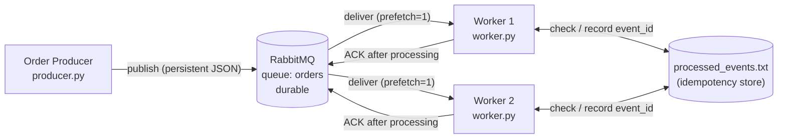

Plain-text version:

```
                                         ACK   ┌────────────────────────┐
                                     ┌────────▶│ Worker 1  (worker.py)  │──┐
┌──────────────────┐   publish   ┌───┴──────┐  └────────────────────────┘  │ check / record
│  Order Producer  │────────────▶│ RabbitMQ │                              ├──────────────▶ processed_events.txt
│  (producer.py)   │             │  queue:  │  ┌────────────────────────┐  │                (event_id set)
└──────────────────┘             │  orders  │─▶│ Worker 2  (worker.py)  │──┘
                                 └──────────┘  └────────────────────────┘
                                                         ACK
  • Each message goes to exactly ONE worker (competing consumers).
  • If a worker dies before ACK, the message is re-queued and redelivered to another worker.
```

### Key design decisions

* **Manual ACKs** (`auto_ack=False`): the ACK is sent only *after* processing finishes. If a worker dies first, RabbitMQ re-queues the message.
* **`basic_qos(prefetch_count=1)`**: each worker holds at most one unacked message, so work is spread round-robin and a crash only "loses" (re-queues) one in-flight message.
* **Durable queue + persistent messages**: messages survive a broker restart.
* **Idempotency**: workers record each processed `event_id` in `processed_events.txt`. The file is shared by both worker processes and protected with an exclusive `flock`, so the check-and-record step is atomic across processes. A message whose `event_id` is already in the file is logged as a **DUPLICATE**, its business action is skipped, and it is ACKed so it leaves the queue.
* **Failure simulation**: `--crash-after N` hard-exits (`os._exit(1)`) on the worker's N-th message *before* the ACK. Add `--crash-after-processing` to crash *after* the business action but still before the ACK, which is the classic at-least-once duplicate case.

---

## How to run

### Prerequisites
* Docker (for RabbitMQ)
* Python 3.9+

### 1. Start RabbitMQ
```bash
docker compose up -d
# Management UI: http://localhost:15672   (user: guest / pass: guest)
```

### 2. Install dependencies
```bash
python3 -m venv .venv
source .venv/bin/activate
pip install -r requirements.txt
```

### 3. Start two workers (two separate terminals)
```bash
# Terminal 1
python worker.py --name worker-1
# Terminal 2
python worker.py --name worker-2
```

### 4. Publish orders (third terminal)
```bash
python producer.py --count 10 --start 1001        # publishes ORD-1001 … ORD-1010
```

### 5. Failure / redelivery demo
```bash
# Terminal 1
python worker.py --name worker-1
# Terminal 2 – this worker dies on its 2nd message without ACKing it
python worker.py --name worker-2 --crash-after 2
# Terminal 3
python producer.py --count 6 --start 2001
```

### 6. Duplicate demo
```bash
python worker.py --name worker-1
# re-publish an event_id that has already been processed
python producer.py --duplicate-of <event_id from processed_events.txt>
```

### 7. Crash after processing (redelivered duplicate)
```bash
python worker.py --name worker-1
python worker.py --name worker-2 --crash-after 1 --crash-after-processing
python producer.py --count 2 --start 4001
```

### One-shot demo
`./scripts/run_demo.sh` runs all four scenarios automatically (workers in the background) and writes logs to `demo-output/`.

### Command reference
| Command | Options |
|---|---|
| `producer.py` | `--count N` (default 10), `--start N` first order number (default 1001), `--duplicate-of EVENT_ID` |
| `worker.py` | `--name NAME`, `--crash-after N`, `--crash-after-processing`, `--work-seconds S` (default 1.0) |

Environment variables: `RABBITMQ_HOST` (default `localhost`), `QUEUE_NAME` (default `orders`), `PROCESSED_FILE` (default `processed_events.txt`).

---

## Results and evidence

All screenshots below are real macOS Terminal windows captured while the scenarios ran. The full logs (written with `tee`) are in [`evidence/`](evidence/).

### 0. RabbitMQ running

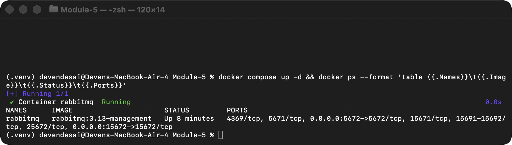

### 1. Successful processing + two competing consumers

The producer publishes 10 orders:

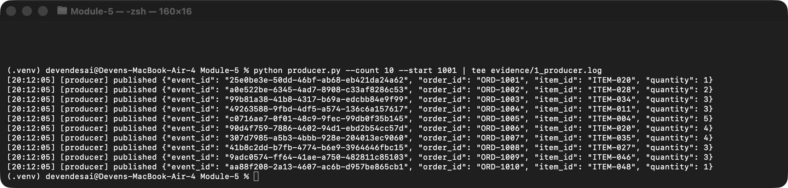

Both workers consume from the **same** `orders` queue. Each order is handled by exactly one worker: worker-1 got 1001, 1003, 1005, 1007, 1010 and worker-2 got 1002, 1004, 1006, 1008, 1009. No order shows up twice and none is missing.

| worker-1 | worker-2 |
|---|---|
| 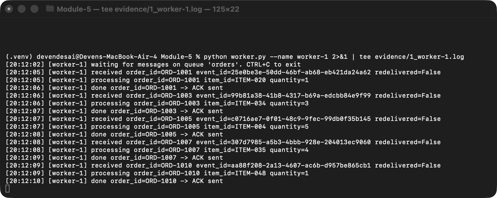 | 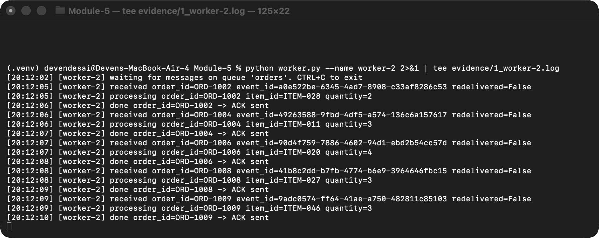 |

RabbitMQ shows **2 consumers** on the `orders` queue, both with `ack_required=true` and `prefetch_count=1`:

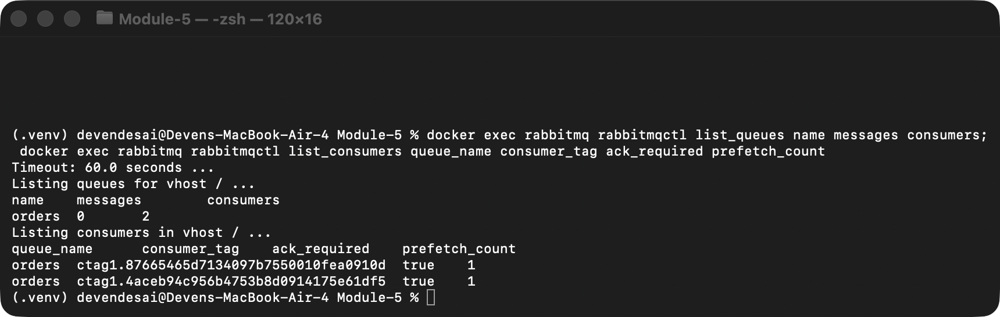

<details>
<summary>Log excerpt (evidence/1_worker-1.log and evidence/1_worker-2.log)</summary>

```
[20:12:05] [worker-1] received order_id=ORD-1001 event_id=25e0be3e-50dd-46bf-ab68-eb421da24a62 redelivered=False
[20:12:05] [worker-1] processing order_id=ORD-1001 item_id=ITEM-020 quantity=1
[20:12:06] [worker-1] done order_id=ORD-1001 -> ACK sent
[20:12:06] [worker-1] received order_id=ORD-1003 ...
[20:12:07] [worker-1] received order_id=ORD-1005 ...
[20:12:08] [worker-1] received order_id=ORD-1007 ...
[20:12:09] [worker-1] received order_id=ORD-1010 ...

[20:12:05] [worker-2] received order_id=ORD-1002 event_id=a0e522be-6345-4ad7-8908-c33af8286c53 redelivered=False
[20:12:05] [worker-2] processing order_id=ORD-1002 item_id=ITEM-028 quantity=2
[20:12:06] [worker-2] done order_id=ORD-1002 -> ACK sent
[20:12:06] [worker-2] received order_id=ORD-1004 ...
[20:12:07] [worker-2] received order_id=ORD-1006 ...
[20:12:08] [worker-2] received order_id=ORD-1008 ...
[20:12:09] [worker-2] received order_id=ORD-1009 ...
```
</details>

### 2. Failure before ACK and redelivery

worker-2 was started with `--crash-after 2`. It **received ORD-2004** and then died **without sending an ACK**:

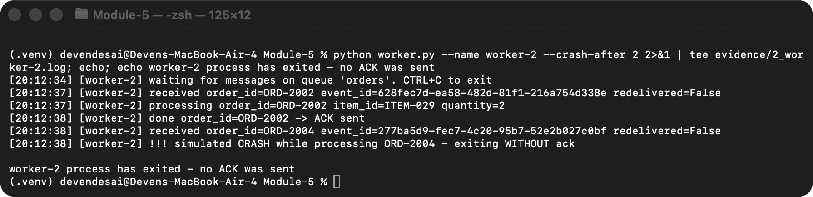

RabbitMQ saw worker-2's connection close with ORD-2004 still unacked, so it re-queued the message. **worker-1 received ORD-2004 again (`redelivered=True`)**, processed it, ACKed it, and then kept consuming ORD-2005 and ORD-2006. The system kept running.

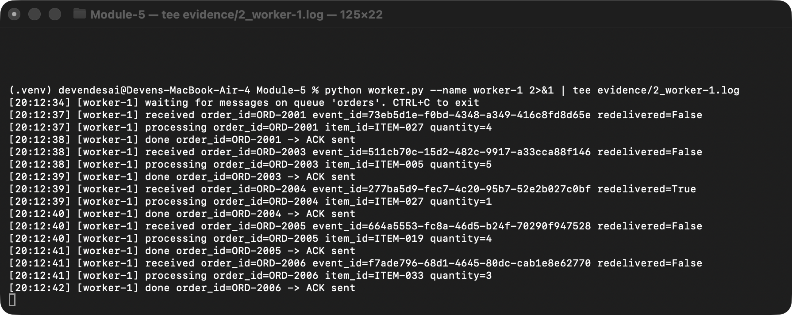

```
[20:12:38] [worker-2] received order_id=ORD-2004 event_id=277ba5d9-fec7-4c20-95b7-52e2b027c0bf redelivered=False
[20:12:38] [worker-2] !!! simulated CRASH while processing ORD-2004 - exiting WITHOUT ack

[20:12:39] [worker-1] received order_id=ORD-2004 event_id=277ba5d9-fec7-4c20-95b7-52e2b027c0bf redelivered=True
[20:12:39] [worker-1] processing order_id=ORD-2004 item_id=ITEM-027 quantity=1
[20:12:40] [worker-1] done order_id=ORD-2004 -> ACK sent
[20:12:40] [worker-1] received order_id=ORD-2005 ... redelivered=False
[20:12:41] [worker-1] received order_id=ORD-2006 ... redelivered=False
```

### 3. Duplicate handling

The producer re-publishes `event_id a0e522be-…` (already processed as ORD-1002 in scenario 1), followed by a new order:

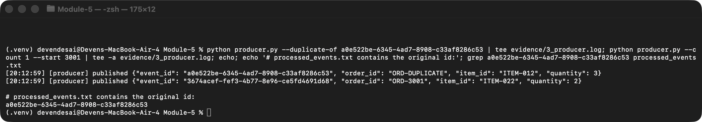

The worker finds the `event_id` in `processed_events.txt`, logs **DUPLICATE detected**, skips the business action, and still ACKs so the message leaves the queue. The next, new order is processed normally:

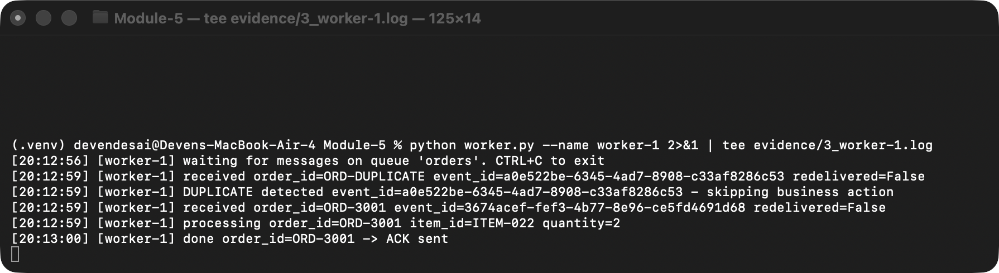

```
[20:12:59] [worker-1] received order_id=ORD-DUPLICATE event_id=a0e522be-6345-4ad7-8908-c33af8286c53 redelivered=False
[20:12:59] [worker-1] DUPLICATE detected event_id=a0e522be-6345-4ad7-8908-c33af8286c53 - skipping business action
[20:12:59] [worker-1] received order_id=ORD-3001 event_id=3674acef-fef3-4b77-8e96-ce5fd4691d68 redelivered=False
[20:12:59] [worker-1] processing order_id=ORD-3001 item_id=ITEM-022 quantity=2
[20:13:00] [worker-1] done order_id=ORD-3001 -> ACK sent
```

### 4. Bonus: crash *after* processing → redelivered duplicate is caught

This is the realistic at-least-once case. worker-2 **finished** the business action for ORD-4002 and then crashed before the ACK:

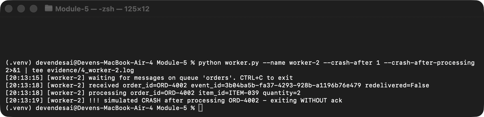

RabbitMQ redelivered ORD-4002 to worker-1 (`redelivered=True`). Because the `event_id` had already been recorded, worker-1 **did not run the business action a second time**:

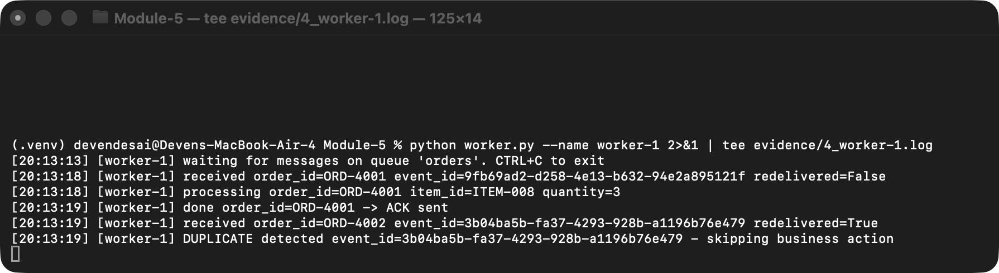

```
[20:13:18] [worker-2] received order_id=ORD-4002 event_id=3b04ba5b-fa37-4293-928b-a1196b76e479 redelivered=False
[20:13:18] [worker-2] processing order_id=ORD-4002 item_id=ITEM-039 quantity=2
[20:13:19] [worker-2] !!! simulated CRASH after processing ORD-4002 - exiting WITHOUT ack

[20:13:19] [worker-1] received order_id=ORD-4002 event_id=3b04ba5b-fa37-4293-928b-a1196b76e479 redelivered=True
[20:13:19] [worker-1] DUPLICATE detected event_id=3b04ba5b-fa37-4293-928b-a1196b76e479 - skipping business action
```

---

## Reflection

**Why can a message be delivered more than once, and how does idempotent handling help?**

RabbitMQ with manual acknowledgements gives *at-least-once* delivery. The broker only deletes a message after it receives an ACK, so if a worker crashes, loses its connection, or times out after it receives a message but before its ACK arrives, the broker cannot tell whether the work was done and re-queues the message for another consumer (scenarios 2 and 4). Producers can also cause duplicates by retrying a publish when they are unsure it succeeded (scenario 3). Idempotent handling makes these duplicates harmless: each message carries a unique `event_id`, and the worker records processed IDs and skips the business action when it sees one again. Processing a message once or many times then has the same effect, which lets us keep the reliability of redelivery without double-charging or double-shipping an order.

---

## Repository layout

```
.
├── producer.py              # Order Producer
├── worker.py                # Order Worker (competing consumer, manual ACK, idempotent)
├── common.py                # shared RabbitMQ connection / queue declaration
├── docker-compose.yml       # RabbitMQ + management UI
├── requirements.txt
├── scripts/run_demo.sh      # runs all scenarios automatically
├── evidence/                # raw logs from the run shown in the screenshots
└── screenshots/             # terminal screenshots for every scenario
```
